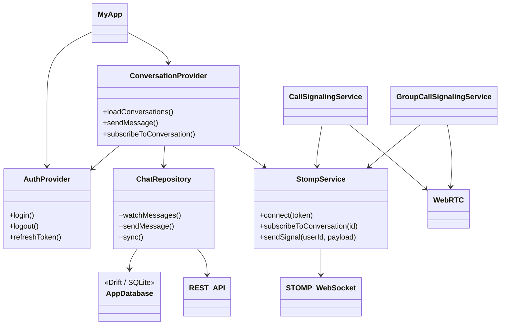
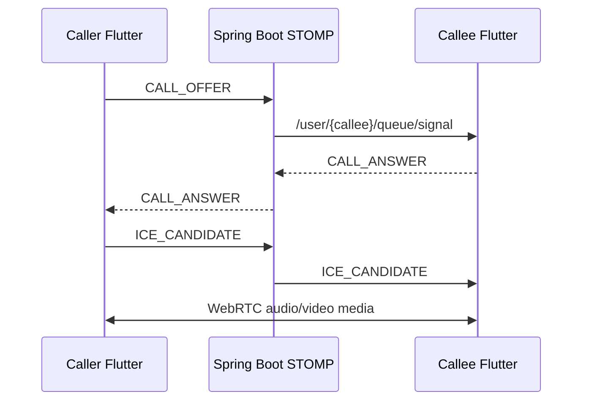

# ChatInLove Frontend

ChatInLove is a Flutter real-time chat client for web and mobile. The client
supports authenticated conversations, group conversations, media messages,
offline-first local storage, presence, push notifications, and one-to-one or
group audio/video calls.

## Requirements

- Flutter stable with Dart SDK `^3.12.2` (see `pubspec.yaml`)
- A running ChatInLove backend for local development
- Firebase configuration for the target platform when using Firebase
  messaging

The app currently uses the deployed Render backend by default:

- REST: `https://chatinlove.onrender.com`
- WebSocket/STOMP: `wss://chatinlove.onrender.com/chat`

These defaults are defined in `lib/api/api.dart`. To use a local backend,
set `USE_REMOTE_BACKEND` to `false` and update `SERVER_IP` for the device or
browser being used. Local development uses port `2026` and derives the REST
and WebSocket URLs from those values. Android emulators can use
`10.0.2.2`; physical devices need the host computer's LAN address.

## Local development

```bash
flutter pub get
flutter run -d chrome
```

Run on another target with `flutter devices` and replace `chrome` with the
target device identifier. Before opening a change, run the checks used by this
project:

```bash
flutter analyze
flutter test
```

The test suite covers request serialization, device/session behavior,
offline-database behavior, and storage calculations (`test/`).

## Web deployment

Vercel uses `vercel.json`, which runs `vercel-build.sh` and publishes
`build/web`. The build script installs Flutter stable into a local `flutter/`
directory when the build environment does not already provide it, then runs:

```bash
flutter pub get
flutter build web --release
```

The Vercel rewrite sends application routes to `index.html`, which is required
for Flutter web navigation.

## Architecture

The UI is composed of screens and widgets. `AuthProvider` owns authentication
state, while `ConversationProvider` coordinates conversation data and
real-time subscriptions. `ChatRepository` combines the REST API with the
Drift/SQLite database for offline-first message access. `StompService` carries
authenticated WebSocket/STOMP events, and the call signaling services use
STOMP to negotiate WebRTC sessions.



### Call signaling flow



## Problems and solutions

| Problem | Solution in this client |
| --- | --- |
| REST requests and call events need different transports. | `AuthProvider`, `ConversationProvider`, and the service classes use REST for resource operations and `StompService` for authenticated real-time events. |
| Messages should remain available during network interruptions. | `ChatRepository` persists and watches messages through Drift/SQLite, while REST/STOMP synchronize server state when connectivity returns. |
| Media URLs can become invalid when the backend host changes. | `resolveFileUrl()` stores server paths and resolves them against the current `REST_URL`, while preserving external URLs and older absolute URLs. |
| WebRTC calls require signaling before peers can exchange media. | `CallSignalingService` and `GroupCallSignalingService` exchange offers, answers, and ICE candidates over STOMP, then hand the negotiated session to WebRTC. |
| Flutter web routes return 404 after a refresh on Vercel. | `vercel.json` rewrites every route to `index.html`, allowing the Flutter web application to handle navigation. |
